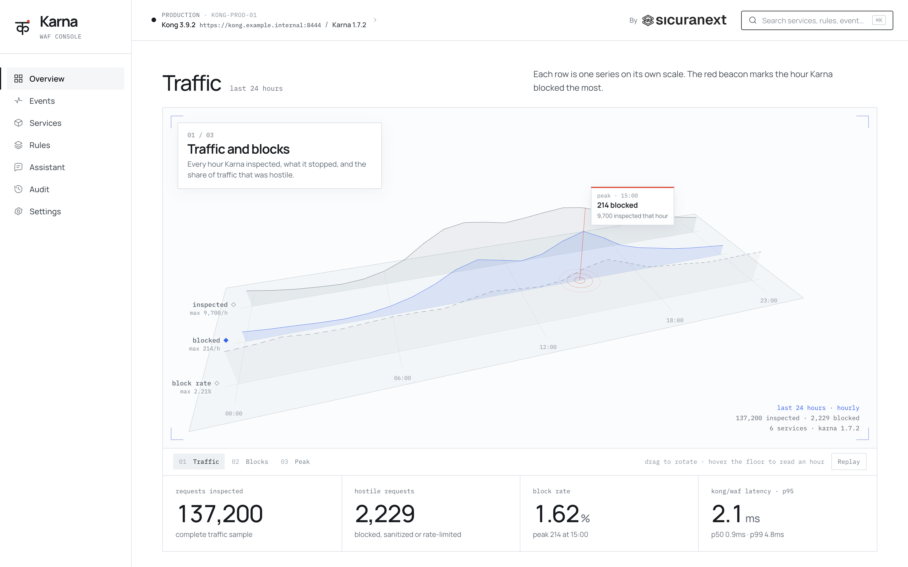

# Let Karna protect your website and APIs.

The fastest Web Application Firewall you can run, designed to be operated by AI
agents. Your agent deploys it, tunes it and writes its rules, so protecting your
apps and APIs is its job while you focus on your business. Full OWASP
CoreRuleSet 4.x detection, 2 to 4 times faster than ModSecurity.

[Website](https://karna.sicuranext.com) · [Documentation](https://karna.sicuranext.com/docs/) · [Benchmark](https://karna.sicuranext.com/benchmark.html) · [Discord](https://discord.gg/FaHMZfmqty)

<a href="https://karna.sicuranext.com/#console"></a>

## Why Karna

- It is fast. On the same hardware, with the same OWASP CRS and the same HTTP
  status on every request, Karna blocks attacks 2 to 4 times faster than
  ModSecurity and 2 to 11 times faster than Coraza.
  [See the benchmark](https://karna.sicuranext.com/benchmark.html).
- It runs all of the OWASP CoreRuleSet 4.x and passes the in-scope part of
  the official regression suite: 100% at paranoia levels 1 and 2, 99.9% at 3
  and 4. A set of built-in fixes switches off the CRS rules known to cause
  false positives in production.
- It can sanitize instead of blocking. When a rule fires on something like
  `O'Brien`, Karna can strip the dangerous characters from that one field and
  let the request through, so a false positive costs a character, not a
  customer.
- It is a Kong plugin, not a module from the Apache era. You attach it to a
  service, a route or a consumer, and you change its rules and settings through
  the Kong Admin API, with no reload and no rebuild.
- You write rules in SecLang, as in ModSecurity, or in JSON. You can change how
  any CRS rule behaves (block, sanitize, let through) without editing it.
- Rate limiting and temporary bans are rule actions, backed by Redis. No second
  plugin to chain.
- It understands MCP: it parses the JSON-RPC envelope, reassembles the SSE
  stream and runs rules on each event.
- It is built to be run by an AI agent. The Karna skill teaches your agent to
  deploy it, tune it and write its rules.
- It logs one JSON entry per request, with every rule that matched, and the
  Karna Console shows you what was blocked and why.

## Installation

To try Karna on your machine you need Docker with the Compose plugin.

```sh
git clone https://github.com/sicuranext/karna
cd karna
./quickstart.sh
```

This starts Kong with Karna, the Karna Console and a demo service. When it is
ready it prints a one-time setup token: open the console at
<http://127.0.0.1:9080> and use it to create your admin account. Then send the
demo service an attack and watch it show up in the console:

```sh
curl "http://127.0.0.1:8000/?q=<script>alert(1)</script>"
```

To run Karna in production, or to add it to a Kong you already run, follow the
[installation guide](https://karna.sicuranext.com/docs/#install).

## Documentation

- [Getting started](https://karna.sicuranext.com/docs/)<br>
  [Overview](https://karna.sicuranext.com/docs/#overview) · [Installation](https://karna.sicuranext.com/docs/#install) · [Attach Karna to a service](https://karna.sicuranext.com/docs/#attach) · [Run detection-only first](https://karna.sicuranext.com/docs/#detection-first)
- [Configuration](https://karna.sicuranext.com/docs/configuration.html)<br>
  [Engine & blocking](https://karna.sicuranext.com/docs/configuration.html#engine) · [CRS category toggles](https://karna.sicuranext.com/docs/configuration.html#crs) · [Engine optimizations](https://karna.sicuranext.com/docs/configuration.html#optimizations) · [Validation gates & limits](https://karna.sicuranext.com/docs/configuration.html#gates) · [CRS-setup knobs](https://karna.sicuranext.com/docs/configuration.html#crs-setup) · [Body parsing](https://karna.sicuranext.com/docs/configuration.html#body) · [MCP (AI / Model Context Protocol)](https://karna.sicuranext.com/docs/configuration.html#mcp) · [CRS exclusion plugins](https://karna.sicuranext.com/docs/configuration.html#crs-plugins) · [Custom rules](https://karna.sicuranext.com/docs/configuration.html#custom-rules) · [Action & response overrides](https://karna.sicuranext.com/docs/configuration.html#overrides) · [Audit logging](https://karna.sicuranext.com/docs/configuration.html#audit) · [Redis](https://karna.sicuranext.com/docs/configuration.html#redis) · [Debug](https://karna.sicuranext.com/docs/configuration.html#debug) · [Identification endpoint](https://karna.sicuranext.com/docs/configuration.html#identify) · [Environment variables](https://karna.sicuranext.com/docs/configuration.html#env)
- [Writing rules](https://karna.sicuranext.com/docs/rules.html)<br>
  [Rule format](https://karna.sicuranext.com/docs/rules.html#format) · [JSON Schema](https://karna.sicuranext.com/docs/rules.html#json-schema) · [Conditions](https://karna.sicuranext.com/docs/rules.html#conditions) · [Phases](https://karna.sicuranext.com/docs/rules.html#phases) · [Variables](https://karna.sicuranext.com/docs/rules.html#variables) · [Operators](https://karna.sicuranext.com/docs/rules.html#operators) · [Negation](https://karna.sicuranext.com/docs/rules.html#negation) · [Transformations](https://karna.sicuranext.com/docs/rules.html#transforms) · [Actions](https://karna.sicuranext.com/docs/rules.html#actions) · [Redis inspection](https://karna.sicuranext.com/docs/rules.html#redis-inspect) · [Rule controls](https://karna.sicuranext.com/docs/rules.html#rule-controls) · [CRS overrides](https://karna.sicuranext.com/docs/rules.html#overrides) · [SecLang rules](https://karna.sicuranext.com/docs/rules.html#seclang) · [Global rules](https://karna.sicuranext.com/docs/rules.html#global-rules) · [TLS fingerprint](https://karna.sicuranext.com/docs/rules.html#tls-fingerprint) · [Example: detect & block](https://karna.sicuranext.com/docs/rules.html#ex-detect) · [Example: sanitize, don't block](https://karna.sicuranext.com/docs/rules.html#ex-sanitize) · [Example: rate limit](https://karna.sicuranext.com/docs/rules.html#ex-ratelimit) · [Example: counter + threshold](https://karna.sicuranext.com/docs/rules.html#ex-counter) · [Example: distributed auto-ban](https://karna.sicuranext.com/docs/rules.html#ex-autoban) · [Example: rate limit, then ban](https://karna.sicuranext.com/docs/rules.html#ex-ratelimit-ban) · [Example: chained rule](https://karna.sicuranext.com/docs/rules.html#ex-chain) · [Example: TLS fingerprint & connection](https://karna.sicuranext.com/docs/rules.html#ex-tls)
- [Install the Karna skill (for AI agents)](https://karna.sicuranext.com/skill/)<br>
  [Tell your agent to install it](https://karna.sicuranext.com/skill/#agent) · [One-line install](https://karna.sicuranext.com/skill/#oneliner) · [Prefer to inspect first?](https://karna.sicuranext.com/skill/#transparent) · [Verify](https://karna.sicuranext.com/skill/#verify) · [For the full experience, clone the repo too](https://karna.sicuranext.com/skill/#full)

## License

Karna is source-available under the [Elastic License 2.0](LICENSE) © SicuraNext s.r.l.

In plain terms: you can read the source, run it, modify it, and redistribute it
for free. You can use it to protect your own applications and the applications
of your clients, including as part of a paid service you provide to them. The
one thing you cannot do is take Karna and offer it to third parties as a hosted
or managed service where Karna itself is the product. For that, a separate
commercial license is available — write to karna@sicuranext.com.

Want to contribute? Please read [CLA.md](CLA.md). You keep the copyright to your
work; the agreement just lets us keep Karna both source-available and
commercially sustainable.

## A note to the community

Karna exists to protect web applications. All of them, not only the ones behind
an expensive enterprise WAF. A small team should be able to put a serious
firewall in front of their app, or in front of their customers' apps, without
asking anyone for permission and without paying a toll.

So why not a plain permissive license? Because we have watched it happen too
many times. A project is given away for free, a handful of maintainers pour
years into it, and then a company with near-infinite resources wraps it in a
console, sells it as a managed service, and sends nothing back. The maintainers
burn out, the project stalls, and everyone who depended on it is left holding
the bag. The Elastic License 2.0 closes exactly that one door and leaves every
other door open.

If you run Karna for yourself or for the people who trust you to keep them safe,
this license was written for you and you owe us nothing. If you are large enough
to want to resell Karna as a service, then talk to us and pay for a commercial
license, so that the money goes back into the project and the people who build
it. That is the whole bargain.

This project is here to protect web apps. It is not here to make the people who
are already rich any richer. Thanks for being part of it.

## What you can and can't do with Karna

Licenses are hard to read, so here it is in plain English. The one question that
decides everything: **are you running Karna, or is your customer running it through
you?** If you run it, you're free to go. If your customer signs up to run their own
Karna through a service you sell them, that needs a commercial license.

✅ **You can**

- Protect your own sites, APIs, and MCP servers — on your own hardware or in your own cloud.
- Set up and run Karna for your clients, on their servers or in their cloud.
- Run Karna on your own infrastructure to protect your clients, as long as you're the one operating it for them.
- Get paid for it: sell your managed service, your consulting, your time keeping clients safe with Karna.
- Read the source, change it, fork it, and share your changes — just keep the license notice and say what you changed.

❌ **You can't**

- Turn Karna into a self-service product where customers sign up and manage their own Karna through you.
- Expose Kong's Admin API (or a custom API) to your customers so they run Karna as a service themselves.

If you want to do something on the red list, that's exactly what the commercial
license is for.

This is a plain-English summary to help you decide, not the license itself. The
[LICENSE](LICENSE) file is what legally counts, and if the two ever disagree, the
LICENSE wins.

**Still not sure which side of the line you're on? Just ask — write to
karna@sicuranext.com and we'll help you figure it out.**
